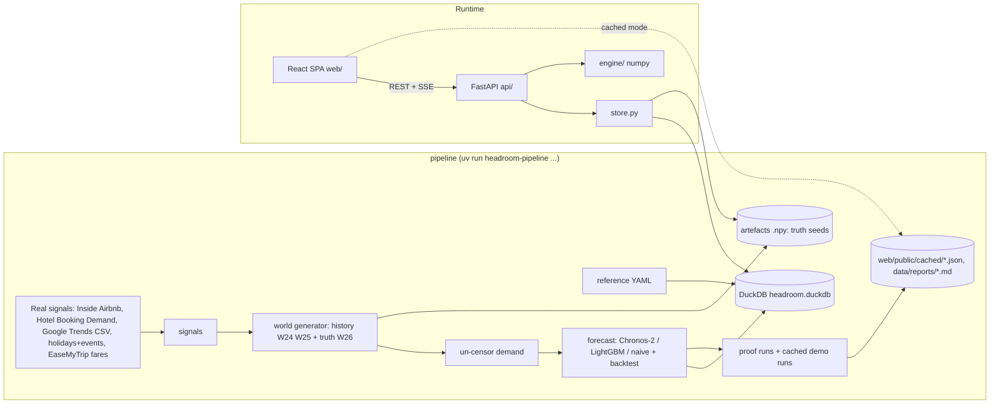
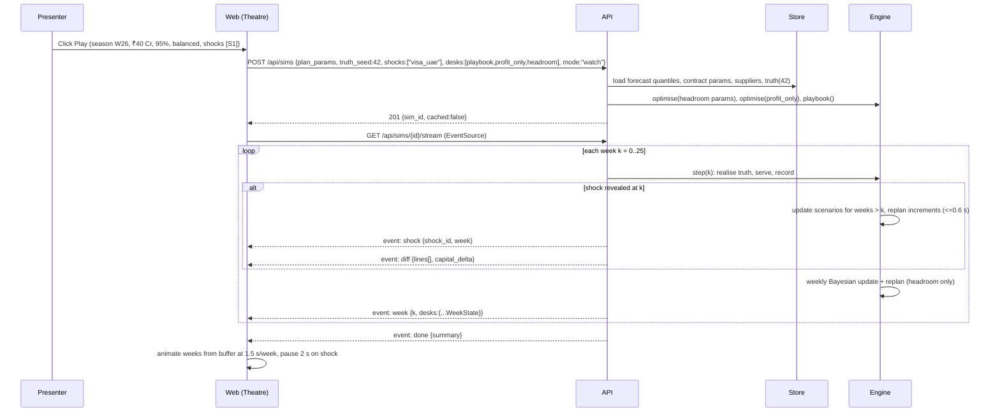

# 04 Architecture

## 1. Components (one responsibility each)
| Component | Path | Responsibility |
|---|---|---|
| Pipeline | `pipeline/` | Offline batch: reference data, real signals, calibrated world, un-censoring, forecast, backtest, proof runs, cached demo runs. Writes DuckDB + Parquet + `.npy`. Never imported by the API at runtime except its shared schema constants. |
| Engine | `engine/` | Pure functions, numpy only: scenarios, recourse, value tables, allocation, supplier loop, baselines, simulator, reasons. No I/O, no DuckDB, no FastAPI. |
| Store | `api/store.py` | The only module that talks to DuckDB and reads artefact files. Returns numpy arrays and plain dataclasses. |
| API | `api/` | FastAPI routes: validate input, call store + engine, persist plans/orders, stream sims. No business rules beyond orchestration and the order state machine. |
| Web | `web/` | React SPA: screens, map, charts, playback. Talks only to the API (or cached JSON). No optimisation logic except the Contract Lab's client-side evaluation of one cell from returned samples. |

## 2. Diagram

ASCII view:
```
pipeline --writes--> DuckDB + .npy + cached JSON
web --REST/SSE--> api --> store --> DuckDB/.npy
                  api --> engine (pure numpy)
web --(API down)--> cached JSON
```

## 3. Data flow through the hero moment

The server runs ahead of playback; the client buffers. Playback always reads from the buffer, so it stays smooth; while a re-plan is computing, the Headroom column shows "Re-planning...".

## 4. Interface contracts

All money is integer INR (rupees, not paise) in JSON. Units are integers. Rates are floats 0-1. Dates ISO `YYYY-MM-DD`. Week index `k` is 0-25 within the season. Errors use `{"error": {"code": str, "message": str, "details": object|null}}`.

### Shared types (pydantic in `api/schemas.py`, mirrored as TS in `web/src/api/types.ts`)
```python
RiskAppetite = Literal["cautious", "balanced", "bold"]
ContractType = Literal["hard", "allot", "free"]
DeskId = Literal["playbook", "profit_only", "headroom", "you"]

class Levers(BaseModel):
    contracts: bool = True      # False = hard only (like profit_only)
    suppliers: bool = True
    pricing: bool = True        # False = fixed 8% markup

class PlanParams(BaseModel):
    season_id: Literal["W25", "W26"] = "W26"
    budget_inr: int = Field(400_000_000, ge=50_000_000, le=1_500_000_000)   # ₹5 Cr - ₹150 Cr
    availability_target: float = Field(0.95, ge=0.80, le=0.99)
    target_scope: Literal["peak", "all"] = "peak"
    risk: RiskAppetite = "balanced"
    levers: Levers = Levers()
    scenarios: int = Field(128, ge=32, le=512)
    seed: int = 7
    force_suppliers: dict[str, bool] = {}   # supplier_id -> forced include/exclude

class BuyLine(BaseModel):
    pool_id: str            # "H-DXB-4"
    week: int               # 0..25
    week_start: date
    hard_units: int
    allot_units: int
    markup: float           # 0.04 | 0.08 | 0.12
    buy_by: date            # hard: signing deadline; allot: contract deadline
    release_by: date | None # allot release cut-off date
    capital_committed_inr: int   # hard cost + allot holding fees
    capital_at_risk_inr: int     # expected unsold hard cost net of salvage + expected utilisation penalty
    exp_demand: float
    exp_served: float
    p_soldout: float        # probability the cell has any sold-out searches
    exp_profit_inr: int
    reason: str             # templated sentence, see 11-engine-spec.md section 8

class SupplierDecision(BaseModel):
    supplier_id: str
    integrate: bool
    forced: bool
    value_inr: int          # objective gain minus integration cost
    cells_helped: int
    live_week: int

class PlanMetrics(BaseModel):
    exp_profit_inr: int
    p10_profit_inr: int
    cvar5_profit_inr: int
    prob_loss: float
    soldout_rate_peak: float      # expected share of peak-cell demand not served
    soldout_rate_all: float
    availability_achievable: float   # best availability reachable at this budget for target_scope
    target_met: bool
    budget_needed_for_target_inr: int | None
    capital_committed_inr: int
    capital_at_risk_inr: int
    capital_price: float           # objective ₹ per ₹ of budget at the margin
    marginal_cr: dict              # {"soldout_pp_per_cr": float, "profit_inr_per_cr": int}
    solve_ms: int
    scenarios: int

class PlanResult(BaseModel):
    plan_id: str            # "pl_" + 10 chars
    params: PlanParams
    metrics: PlanMetrics
    lines: list[BuyLine]    # only cells with hard_units + allot_units > 0 or markup != 0.08
    suppliers: list[SupplierDecision]
    created_at: datetime
```

### Endpoints
| Method, path | Request | Response | Failure paths |
|---|---|---|---|
| GET `/api/health` | | `{"status":"ok","db":true,"artefacts":true,"version":"0.1.0"}` | 503 with which part is missing |
| GET `/api/meta` | | `{seasons, destinations[], hubs[], pools[], suppliers[], shocks[], contract_params, provenance[]}` | 503 if DB missing |
| POST `/api/plans` | `PlanParams` | 201 `PlanResult` | 422 invalid; 503 forecast missing for season |
| GET `/api/plans/{plan_id}` | | `PlanResult` | 404 |
| POST `/api/plans/frontier` | `{params: PlanParams, budgets_inr: int[] (2-16)}` | `{points:[{budget_inr, soldout_rate_peak, exp_profit_inr, cvar5_profit_inr, target_met}]}` | 422 |
| GET `/api/demand` | `?pool_id=H-DXB-5&season_id=W26` | `{weeks:[{k, week_start, bookings, soldout_searches, demand_unc, searches, q05..q95 (forecast seasons only), is_peak, events[]}], signals:{trends[], airbnb_pressure[] or null, holidays[]}, backtest:{model, wql, coverage}}` | 404 pool |
| GET `/api/contract-lab` | `?pool_id&week&plan_id?` | `{cell, params (contract), demand_samples:int[256], free_cap_share_samples:float[256], free_rate_samples:float[256], curves:{units:int[], hard:{mean,p10,p90}[], allot:{...}[], mix:{...}[]}, p_soldout:{units:int[], prob:float[]}, headroom_mix:{hard,allot,markup}|null}` | 404 |
| POST `/api/sims` | `{params: PlanParams, truth_seed: int (0-499 or 42), shocks: str[], desks: DeskId[], mode: "watch"|"play"}` | 201 `{sim_id, cached: bool, weeks: 26}` | 422 |
| GET `/api/sims/{sim_id}/stream` | SSE | events below | 404; stream sends `event: error` then closes on engine error |
| POST `/api/sims/{sim_id}/act` | `{week:int, actions:[{type:"topup_allot"|"buy_hard"|"release_allot"|"set_markup", pool_id, weeks:int[], units?:int, markup?:float}]}` | 200 `{accepted:[...], rejected:[{action, reason}], budget_left_inr}` | 409 wrong week / not play mode |
| POST `/api/sims/{sim_id}/advance` | `{}` (play mode) | 200 `{week}` and the stream emits the next week | 409 |
| GET `/api/proof` | | precomputed proof JSON (F19) | 503 if not generated |
| POST `/api/orders/from-plan/{plan_id}` | `{submitted_by:"contracting"}` | 201 `{orders:[Order]}` | 404 plan; 409 already submitted |
| GET `/api/orders` | `?state&destination&contract` | `{orders:[Order], totals}` | |
| POST `/api/orders/{order_id}/transition` | `{action:"approve"|"reject"|"withdraw"|"send"|"confirm"|"decline", actor_role:"contracting"|"finance", comment?:str}` | 200 `Order` | 409 illegal transition (message names allowed actions); 403 wrong role |
| GET `/api/orders/export.csv` | same filters | `text/csv`, all rows | |
| GET `/api/audit` | `?entity_id` | `{entries:[{occurred_at, actor_role, entity, entity_id, action, from_state, to_state, comment}]}` | |

### SSE events (`/api/sims/{id}/stream`)
```
event: week
data: {"k":9,"week_start":"2026-12-07","desks":{
  "headroom":{"by_dest":{"DXB":{"demand":5120,"served":4980,"soldout_searches":560,"secured_hard":1400,"secured_allot":2600,"free_used":980,"profit_inr":5400000,"p_soldout_next":0.12}, ...},
              "totals":{"soldout_rate_peak_cum":0.049,"soldout_rate_all_cum":0.021,"profit_inr_cum":231000000,"capital_committed_inr":352000000,"capital_at_risk_inr":61000000,"units_wasted_cum":420}},
  "playbook":{...}, "profit_only":{...}}}

event: shock
data: {"k":9,"shock_id":"visa_uae","title":"UAE eases visa on arrival for Indians","effect":"Dubai and Abu Dhabi demand +25% from week 9","fictional":true}

event: diff
data: {"k":9,"desk":"headroom","replan_ms":412,"lines":["+180 Dubai core allotment (wk 10-13)", "..."],"capital_delta_inr":19000000}

event: done
data: {"summary":{"headroom":{...totals}, "playbook":{...}, "profit_only":{...}}, "result_line":"Same ₹40 Cr. Headroom ..."}
```
`p_soldout_next` drives the radar haze for the following week.

### Engine function contracts (`engine/`)
```python
generate_scenarios(fq: ForecastQuantiles, S: int, seed: int, copula: CopulaParams) -> Scenarios   # D[S,C], Fcap[S,C], c_free[S,C] float32
value_tables(sc: Scenarios, cp: ContractArrays, grid: Grid, committed: Commitments | None) -> Tables
allocate(tables: Tables, budget: float, target: float, scope_mask: bool[C], beta: float, warm: Warm | None) -> Allocation
optimise(inputs: EngineInputs, params: PlanParams) -> EnginePlan     # calls the above + supplier loop + metrics + reasons
playbook(inputs, params) -> EnginePlan
profit_only(inputs, params) -> EnginePlan
simulate(inputs, params, truth: Truth, shocks: list[Shock], desks: list[DeskId]) -> Iterator[SimEvent]
```
`EngineInputs` holds every array the engine needs, built by `store.load_engine_inputs(season_id)`. The engine never reads files.

## 5. File layout and seams
```
headroom/
  CLAUDE.md  CONTEXT.md  brief.md  README.md  plan/
  pyproject.toml  uv.lock            # one Python project, dependency groups: api, pipeline, dev
  engine/
    __init__.py
    types.py          # dataclasses: Scenarios, ContractArrays, Grid, Tables, Allocation, EnginePlan, WeekState, SimEvent
    scenarios.py      # quantile interpolation, copula, free-sale capacity/rate scenarios, Bayesian update
    recourse.py       # serve(h, a, demand, fcap, ...) vectorised; the single source of truth for outcomes
    tables.py         # value tables over the grid (calls recourse)
    allocate.py       # bisection on capital price and availability weight, risk weight
    suppliers.py      # greedy supplier loop
    baselines.py      # playbook, profit_only
    simulate.py       # season loop, replan increments, shocks, release at cut-off
    reasons.py        # templated reason sentences and diff lines
    metrics.py        # portfolio P10, CVaR, availability, capital at risk
    tests/            # TDD: recourse, tables, allocate, exact gap, monotonicity, simulate, perf (slow)
  pipeline/
    __main__.py       # CLI: reference | signals | world | demand | forecast | proof | cache-demo | all
    reference.py  signals/ (airbnb.py, hotel_bookings.py, trends.py, events.py, fares.py)
    world.py  uncensor.py  forecast/ (chronos.py, lgbm.py, naive.py, backtest.py)  proof.py  cache_demo.py
    tests/
  api/
    main.py           # app factory, CORS, routers
    schemas.py        # pydantic models above
    store.py          # ONLY DuckDB/file access
    routes/ (meta.py, plans.py, demand.py, contract_lab.py, sims.py, orders.py, proof.py)
    orders.py         # order state machine (pure)
    sim_registry.py   # in-memory sim runs (dict) + cache lookup
    tests/
  data/
    reference/*.yaml       # committed
    raw/                   # git-ignored downloads
    signals/*.parquet      # committed if licence allows (derived data)
    artefacts/*.npy        # git-ignored, rebuilt by pipeline; small demo set committed (truth seed 42)
    headroom.duckdb        # git-ignored, rebuilt by `pipeline all`
    reports/*.md           # committed
  web/
    package.json  vite.config.ts  index.html
    public/cached/*.json   # committed cached demo runs + proof
    src/
      main.tsx  App.tsx  routes.tsx
      styles/tokens.css  styles/global.css
      api/ (client.ts, types.ts, hooks.ts, sse.ts)
      state/ (playback.ts, plan.ts, role.ts)          # zustand stores
      components/ (Shell, Header, Nav, Badge, Chip, Slider, Segmented, Stat, Sparkline, EmptyState, ErrorState, Skeleton, Toast)
      charts/ (Fan.tsx, Frontier.tsx, Lanes.tsx, Payoff.tsx, Strip.tsx, axes.ts, scales.ts)
      map/ (PressureMap.tsx, layers/gauges.ts, layers/sparks.ts, layers/flights.ts, layers/haze.ts, projection.ts, land.ts)
      screens/ (Theatre.tsx, PlanStudio.tsx, ContractLab.tsx, Suppliers.tsx, DemandLens.tsx, Approvals.tsx, Proof.tsx)
      lib/ (format.ts, lab-eval.ts)    # format: ₹ Cr/L, %, dates; lab-eval: client recourse for one cell
      mocks/ (weekStates.ts)
    tests/ (unit/*.test.ts, e2e/demo-journey.spec.ts)
  docker-compose.yml  Dockerfile.api  Dockerfile.web(optional)  Makefile
```
Seams and rules (each with what it protects):
- Only `api/store.py` touches DuckDB or artefact files. Protects: one place to fix data bugs; the engine stays testable with plain arrays.
- `engine/` imports numpy (and scipy.stats for the normal inverse CDF) only; never pandas, DuckDB or FastAPI. Protects: speed, determinism, and the exact-gap test.
- `engine/recourse.py` is the only code that computes outcomes from commitments and demand. Tables, baselines, simulator and the Contract Lab endpoint all call it; `web/src/lib/lab-eval.ts` is a line-by-line port tested against fixtures exported from Python. Protects: every number on screen agrees.
- Routes never contain business rules; they validate, call, persist. The order state machine lives in `api/orders.py` as a pure function `transition(state, action, role) -> new_state | error`. Protects: testable approvals.
- The web never computes plans; it only formats and animates. Protects: no drift between UI and engine.
- Reasons and diff lines come from `engine/reasons.py` templates. No LLM. Protects: auditability.

## 6. External dependencies
| Dependency | Link | Auth | Limits | Licence | Committed snapshot |
|---|---|---|---|---|---|
| Inside Airbnb calendars | https://insideairbnb.com/get-the-data/ | none | large files | CC BY 4.0 (check the page footer when downloading; record in provenance) | derived parquet committed |
| Hotel Booking Demand (Antonio, de Almeida, Nunes 2019, Data in Brief) | https://doi.org/10.1016/j.dib.2018.11.126 (data also mirrored on Kaggle and TidyTuesday 2020-02-11) | none | 119,390 rows | CC BY 4.0 per the article (verify on download) | derived curves committed |
| Google Trends | https://trends.google.com (Explore, geo India, 5 years, category Travel) | none | manual export | Google ToS: use derived index only | CSVs committed |
| Indian holidays | `holidays` package | none | | MIT | offline |
| Event calendar | curated `data/reference/events.yaml` with a URL per event | none | | n/a | committed |
| EaseMyTrip flight fares (Kaggle "Flight Price Prediction") | https://www.kaggle.com/datasets/shubhambathwal/flight-price-prediction | Kaggle login | | check dataset page; if not commercial-friendly, use only the derived days-left multiplier curve as a calibration and say so | derived curve committed |
| Chronos-2 weights | https://huggingface.co/amazon/chronos-2 | none | ~120 M params | Apache-2.0 | downloaded once in pipeline; forecasts committed in DuckDB rebuild + parquet |
At runtime the app has zero external dependencies.

## 7. Environment variables
API (`api/.env`, see `.env.example`):
- `HEADROOM_DB_PATH` path to `headroom.duckdb` (default `data/headroom.duckdb`).
- `HEADROOM_ARTEFACTS_DIR` path to `.npy` artefacts (default `data/artefacts`).
- `HEADROOM_CORS_ORIGINS` comma-separated allowed origins (default `http://localhost:5173`).
- `HEADROOM_DEFAULT_SCENARIOS` default S for plans (128).
- `HEADROOM_SIM_SCENARIOS` S for in-season re-plans (64).
- `HEADROOM_LOG_LEVEL` (info).
- STRETCH only: `HEADROOM_LLM_BASE_URL`, `HEADROOM_LLM_API_KEY`, `HEADROOM_LLM_MODEL`.
Web (`web/.env`):
- `VITE_API_BASE` API origin (default `http://localhost:8000`).
- `VITE_FORCE_CACHED` `1` forces cached-run mode (for recording or when offline).
