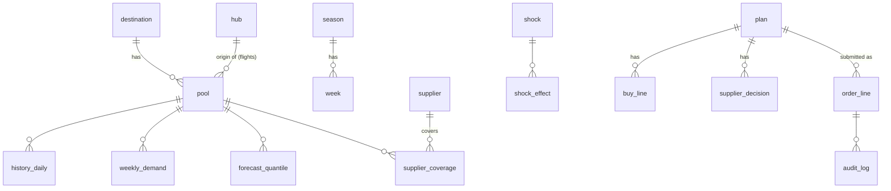

# 05 Data model

Store: DuckDB file `data/headroom.duckdb`. Runnable DDL: `plan/schema.sql`. **This doc and `schema.sql` must stay in sync; change both in the same commit.**
Large arrays (scenario and truth tensors) are `.npz`/`.npy` files in `data/artefacts/`, described at the end.

## ER diagram

## Reference tables
- `destination(dest_id TEXT PK, name TEXT, lat DOUBLE, lon DOUBLE, region TEXT, weight DOUBLE, airbnb_city TEXT NULL, trends_term TEXT, airport TEXT)`
- `hub(hub_id TEXT PK, name TEXT, lat DOUBLE, lon DOUBLE, share DOUBLE)`
- `pool(pool_id TEXT PK, kind TEXT CHECK kind IN ('hotel','flight'), dest_id TEXT FK, tier TEXT NULL CHECK tier IN ('value','core','premium'), hub_id TEXT NULL FK, ref_rate_inr INTEGER, label TEXT)`; id formats `H-<DEST>-<3|4|5>`, `F-<HUB>-<DEST>`.
- `season(season_id TEXT PK, start_date DATE, end_date DATE, plan_date DATE NULL)`
- `week(season_id TEXT, k INTEGER 0..25, week_start DATE, PRIMARY KEY(season_id,k))`
- `contract_param(param TEXT, pool_kind TEXT, value DOUBLE, assumption BOOLEAN, note TEXT, PRIMARY KEY(param,pool_kind))`
- `supplier(supplier_id TEXT PK, name TEXT, description TEXT, cost_inr INTEGER, live_weeks INTEGER, rate_factor DOUBLE, fictional BOOLEAN DEFAULT TRUE)`
- `supplier_coverage(supplier_id TEXT FK, pool_id TEXT FK, boost_share DOUBLE, PRIMARY KEY(supplier_id,pool_id))` boost_share = extra free-sale units as a share of P50 demand.
- `shock(shock_id TEXT PK, title TEXT, effect_text TEXT, reveal_week INTEGER, fictional BOOLEAN DEFAULT TRUE)`
- `shock_effect(shock_id TEXT FK, dest_id TEXT, pool_kind TEXT NULL, tiers TEXT NULL, week_from INTEGER, week_to INTEGER, target TEXT CHECK target IN ('demand','free_cap'), announced_mult DOUBLE, true_mult DOUBLE)`
- `event(event_id TEXT PK, name TEXT, dest_ids TEXT, start_date DATE, end_date DATE, intensity DOUBLE, source_url TEXT NULL, assumption BOOLEAN)`
- `provenance(source_id TEXT PK, name TEXT, url TEXT, licence TEXT, fetched_on DATE, used_for TEXT, kind TEXT CHECK kind IN ('real','derived','assumption'))`

## Data tables (pipeline output)
- `history_daily(season_id, pool_id, date, demand_true INTEGER, searches INTEGER, bookings_gross INTEGER, cancellations INTEGER, served INTEGER, soldout_searches INTEGER, secured_hard INTEGER, free_cap INTEGER, ref_rate_inr INTEGER, free_rate_inr INTEGER, pressure DOUBLE, PK(season_id,pool_id,date))`. `demand_true` is kept for validation tests only; the API never serves it.
- `truth_daily` same columns for W26 seed 42 (hidden; used by the simulator through artefacts; API never serves it).
- `weekly_demand(season_id, pool_id, k, searches, bookings, soldout_searches, served, demand_unc DOUBLE, conv_rate DOUBLE, is_peak BOOLEAN, PK(season_id,pool_id,k))`
- `covariate_week(season_id, dest_id, k, holiday_in INTEGER, event_intensity DOUBLE, airbnb_pressure DOUBLE, has_airbnb BOOLEAN, trends_index DOUBLE, PK(season_id,dest_id,k))`
- `forecast_quantile(season_id, pool_id, k, model TEXT, q05, q10, q25, q50, q75, q90, q95 DOUBLE, chosen BOOLEAN, PK(season_id,pool_id,k,model))`
- `backtest_metric(model TEXT, pool_kind TEXT, wql DOUBLE, coverage_80 DOUBLE, n_cells INTEGER, PK(model,pool_kind))`
- `copula_param(name TEXT PK, value DOUBLE)` rows `a_g`, `a_d`, `a_w`.

## App tables (API writes)
- `plan(plan_id TEXT PK, params_json JSON, metrics_json JSON, created_at TIMESTAMP)`
- `buy_line(plan_id TEXT FK, pool_id TEXT, k INTEGER, hard_units INTEGER, allot_units INTEGER, markup DOUBLE, buy_by DATE, release_by DATE NULL, capital_committed_inr BIGINT, capital_at_risk_inr BIGINT, exp_demand DOUBLE, exp_served DOUBLE, p_soldout DOUBLE, exp_profit_inr BIGINT, reason TEXT, PK(plan_id,pool_id,k))`
- `supplier_decision(plan_id TEXT FK, supplier_id TEXT, integrate BOOLEAN, forced BOOLEAN, value_inr BIGINT, cells_helped INTEGER, live_week INTEGER, PK(plan_id,supplier_id))`
- `order_line(order_id TEXT PK, plan_id TEXT FK, pool_id TEXT, k INTEGER, hard_units INTEGER, allot_units INTEGER, markup DOUBLE, capital_committed_inr BIGINT, state TEXT, submitted_by TEXT, decided_by TEXT NULL, comment TEXT NULL, created_at TIMESTAMP, updated_at TIMESTAMP)`; `order_id` = `ord_` + 10 chars. Unique `(plan_id,pool_id,k)`.
- `audit_log(entry_id BIGINT PK (sequence), occurred_at TIMESTAMP, actor_role TEXT, entity TEXT, entity_id TEXT, action TEXT, from_state TEXT NULL, to_state TEXT NULL, comment TEXT NULL)`
- Sims are not persisted in DuckDB (in-memory registry + cached JSON files). Reason: they are reproducible from params and seeds.

## Enums and transitions
`order_line.state` (initial `pending_approval`):
| From | Action | Role allowed | To | Terminal? |
|---|---|---|---|---|
| pending_approval | approve | finance | approved | no |
| pending_approval | reject | finance | rejected | yes |
| pending_approval | withdraw | contracting | withdrawn | yes |
| approved | send | contracting | sent_to_supplier | no |
| approved | withdraw | contracting | withdrawn | yes |
| sent_to_supplier | confirm | contracting | confirmed | yes |
| sent_to_supplier | decline | contracting | declined_by_supplier | yes |
Any other combination: 409 with `allowed_actions` listed. Wrong role: 403. Every transition writes an `audit_log` row. Submitting a plan writes one `submit` audit row per order (from_state NULL).

Other enums: `pool.kind` hotel|flight; `pool.tier` value|core|premium; `RiskAppetite` cautious|balanced|bold; `ContractType` hard|allot|free; `DeskId` playbook|profit_only|headroom|you; `provenance.kind` real|derived|assumption; `shock_effect.target` demand|free_cap.

## Permissions (demo roles, header switcher)
| Action | contracting | finance |
|---|---|---|
| Run plans, sims, labs | yes | yes |
| Submit plan for approval | yes | no |
| Approve / reject | no | yes |
| Withdraw, send, confirm, decline | yes | no |
| Export CSV, read audit | yes | yes |
The role is sent as `actor_role` in the body; the API checks it. Documented as demo auth in README.

## Seed data (`data/reference/*.yaml`)

### Destinations (weight, Airbnb city, airport) and hotel reference rates in ₹ per room-night (value / core / premium), all rates and weights are assumptions
| dest_id | name | lat, lon | region | weight | airbnb_city | airport | value | core | premium |
|---|---|---|---|---|---|---|---|---|---|
| DXB | Dubai | 25.20, 55.27 | Gulf | 1.00 | null | DXB | 5,500 | 9,000 | 18,000 |
| BKK | Bangkok | 13.75, 100.50 | SE Asia | 0.70 | bangkok | BKK | 3,000 | 5,500 | 11,000 |
| SIN | Singapore | 1.29, 103.85 | SE Asia | 0.55 | singapore | SIN | 8,000 | 13,000 | 24,000 |
| DPS | Bali | -8.65, 115.22 | SE Asia | 0.35 | null | DPS | 3,500 | 7,000 | 16,000 |
| KUL | Kuala Lumpur | 3.14, 101.69 | SE Asia | 0.30 | null | KUL | 3,000 | 5,000 | 10,000 |
| MLE | Maldives | 4.18, 73.51 | Indian Ocean | 0.20 | null | MLE | 12,000 | 25,000 | 55,000 |
| IST | Istanbul | 41.01, 28.98 | Europe | 0.20 | istanbul | IST | 4,500 | 8,000 | 16,000 |
| LON | London | 51.51, -0.13 | Europe | 0.35 | london | LHR | 10,000 | 16,000 | 32,000 |
| PAR | Paris | 48.86, 2.35 | Europe | 0.25 | paris | CDG | 10,000 | 17,000 | 34,000 |
| HKG | Hong Kong | 22.32, 114.17 | East Asia | 0.15 | hong-kong | HKG | 7,000 | 12,000 | 22,000 |

### Hubs
DEL Delhi (28.56, 77.10, share 0.40), BOM Mumbai (19.09, 72.87, 0.35), BLR Bengaluru (13.20, 77.71, 0.25).

### Flight routes (15) and reference one-way economy fare ₹ (assumption)
DEL/BOM/BLR to DXB (14,000), BKK (13,000), SIN (15,000), KUL (12,000), DPS (22,000). Ids `F-DEL-DXB` etc. Routes are city pairs; connections allowed.

### Contract parameters
As in 11-engine-spec.md section 2. Store each as a `contract_param` row with `assumption = true` except `late_cancel` (derived from real data).

### Suppliers (all fictional names; never use real company names)
| supplier_id | name | covers | cost | live in | boost_share | rate_factor |
|---|---|---|---|---|---|---|
| sup_sahara | Sahara Beds (GCC bed bank) | H-DXB-* | ₹1.2 Cr | 4 weeks | 0.15 | 0.99 |
| sup_andaman | Andaman DMC (Thailand and Bali) | H-BKK-3, H-BKK-4, H-DPS-3, H-DPS-4 | ₹0.9 Cr | 5 weeks | 0.20 | 0.97 |
| sup_merlion | Merlion Wholesale (Singapore, KL) | H-SIN-*, H-KUL-* | ₹0.8 Cr | 6 weeks | 0.15 | 0.98 |
| sup_atoll | Atoll Resorts Rep (Maldives) | H-MLE-4, H-MLE-5 | ₹0.6 Cr | 3 weeks | 0.25 | 0.96 |
| sup_bosporus | Bosporus Consolidator (Istanbul, London, Paris) | H-IST-*, H-LON-*, H-PAR-* | ₹1.5 Cr | 8 weeks | 0.10 | 0.99 |
| sup_skyblock | SkyBlock seat consolidator | F-* | ₹2.0 Cr | 6 weeks | 0.10 | 0.97 |

### Shocks (all fictional; UI label "Simulated shock")
| shock_id | title | reveal wk | effect | announced | true |
|---|---|---|---|---|---|
| visa_uae | UAE eases visa on arrival for Indians | 9 | DXB hotels and F-*-DXB demand, wk 9-25 | x1.25 | x1.21 |
| bkk_concert | Two extra stadium concerts announced in Bangkok | 6 | H-BKK-4, H-BKK-5 demand, wk 15-16 | x1.40 | x1.46 |
| bali_ash | Volcanic ash closes Bali airport for 4 days | 13 | DPS hotels and F-*-DPS demand, wk 13-14 | x0.40 | x0.45 |
| inr_weak | Rupee weakens 4% against the euro and pound | 11 | LON, PAR demand, wk 11-25 | x0.92 | x0.90 |
| sg_expo | A mega exhibition is added in Singapore | 10 | H-SIN-4, H-SIN-5 demand, wk 19-20 | x1.30 | x1.33 |
| bom_dxb_cut | A carrier cuts Mumbai-Dubai capacity | 7 | F-BOM-DXB free_cap, wk 8-25 | x0.50 | x0.50 |

### Events
See 10-data-pipeline.md S4 for the minimum list; each row must carry a `source_url`.

### Demo users
Roles only: "Contracting manager" and "Finance approver". No passwords.

## Artefacts (not in DuckDB)
- `data/artefacts/truth_42.npz`: arrays `D, Fcap, cf` each float32 shape `(1170,)` for W26 realistic path, plus `shock_true` multipliers applied.
- `data/artefacts/truth_proof.npz`: `D, Fcap, cf` shape `(500, 1170)` float32.
- `data/artefacts/served_W25.npy`: `(1170,)` served units in W25 by cell index (for the playbook baseline).
Cell index order is pool-major as in 11-engine-spec.md.
